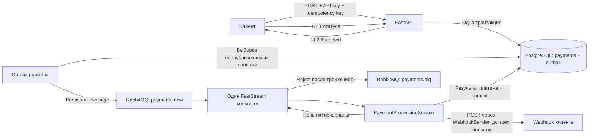

# Asynchronous Payment Processing Service

Асинхронный сервис обработки платежей на **FastAPI, PostgreSQL и RabbitMQ**.
API принимает платёж и возвращает `202 Accepted`, а фоновый обработчик эмулирует
платёжный шлюз, сохраняет результат и отправляет клиенту webhook.

Проект реализует **Transactional Outbox**, идемпотентное создание платежей,
**три попытки доставки webhook** с экспоненциальной задержкой и **Dead Letter Queue**.
Реальный платёжный провайдер не подключён: обработка моделируется задержкой
2–5 секунд и случайным результатом — 90% `succeeded`, 10% `failed`.

| Возможность | Реализация |
| --- | --- |
| Создание платежа | `POST /api/v1/payments`, ответ `202 Accepted` |
| Получение платежа | `GET /api/v1/payments/{payment_id}` |
| Аутентификация API | Статический ключ в `X-API-Key` |
| Защита от дублей | Обязательный `Idempotency-Key` и уникальное ограничение PostgreSQL |
| Публикация событий | Outbox в одной транзакции с платежом; подтверждение RabbitMQ перед отметкой публикации |
| Обработка | Один FastStream consumer: эмуляция → сохранение → webhook → retry |
| Ошибки webhook | До трёх отправок; паузы 1 и 2 секунды; затем `payments.dlq` |
| Запуск | Docker Compose или локальные Python-процессы с инфраструктурой в Docker |
| Автотесты | 35 сценариев pytest без подключения к реальным БД, RabbitMQ и webhook |

## Содержание

- [Запуск и все проверки одной командой](#запуск-и-все-проверки-одной-командой)
- [Быстрый запуск в Docker](#быстрый-запуск-в-docker)
- [Стек технологий](#стек-технологий)
- [Архитектура и обработка платежа](#архитектура-и-обработка-платежа)
- [Настройки окружения](#настройки-окружения)
- [Контракт API](#контракт-api)
- [Примеры запросов](#примеры-запросов)
- [Webhook, retry и DLQ](#webhook-retry-и-dlq)
- [Сквозная проверка в Docker](#сквозная-проверка-в-docker)
- [Локальная разработка](#локальная-разработка)
- [Модели и миграции](#модели-и-миграции)
- [Управление сервисами и диагностика](#управление-сервисами-и-диагностика)
- [Тесты и качество кода](#тесты-и-качество-кода)
- [Структура проекта](#структура-проекта)
- [Гарантии и ограничения](#гарантии-и-ограничения)

## Запуск и все проверки одной командой

Из корня проекта выполните:

```bash
./run.sh
```

Нужны Bash, Docker и Docker Compose. Python на компьютере не требуется: проверки
выполняются внутри образа приложения. Точка входа — [run.sh](run.sh), вспомогательный
получатель webhook и интеграционные сценарии — [scripts/check_docker.py](scripts/check_docker.py).

| Этап | Что делает скрипт |
| --- | --- |
| Подготовка | Проверяет Docker и Compose; создаёт `.env` из примера, только если файла ещё нет |
| 1. Сборка | Один раз собирает общий образ Python-сервисов |
| 2. Запуск | Запускает PostgreSQL, RabbitMQ, миграции, API, consumer и publisher |
| 3. Качество кода | Запускает Ruff и 35 автотестов в отдельном временном контейнере |
| 4. Интеграция | Проверяет API-ключ, полный путь платежа, повторный ключ, 20 конкурентных POST, успех webhook на второй/третьей попытке, HTTP 500, тайм-аут, недоступный получатель и DLQ |
| 5. Сбой брокера | Временно останавливает RabbitMQ, создаёт платёж и проверяет неопубликованную запись Outbox |
| 6. Восстановление | Запускает RabbitMQ, ждёт автоматической публикации и webhook |

Скрипт использует **текущую тестовую БД из `.env`**. Он добавляет платежи с уникальными
ключами `payment-check-...`; записи и сообщения DLQ остаются для просмотра.
Существующие данные и очереди не очищаются. Сценарии запускайте последовательно:
проверка восстановления останавливает общий RabbitMQ.

При успехе выводятся строки `PASS` и итоговое сообщение. Сервисы приложения остаются
работать; временные контейнеры получателя и проверок удаляются. Если проверка не прошла,
скрипт возвращает ненулевой код и показывает команды диагностики. При обычном прерывании
через `Ctrl+C` он также пытается вернуть остановленный RabbitMQ в работу.

Первый запуск занимает время на скачивание образов. Сами интеграционные проверки
занимают несколько минут, в том числе из-за настоящих тайм-аутов webhook.
Это автоматизация перечисленных ниже проверок, а не проверка всех возможных аварий:
downgrade миграций, очистка БД и сбой в точке между публикацией и commit не выполняются.

Остановка приложения после работы:

```bash
docker compose stop
```

Справка: `./run.sh --help`. Для запуска приложения без проверок используйте
обычный Docker-сценарий следующего раздела.

## Быстрый запуск в Docker

### Что потребуется

| Инструмент | Для чего нужен |
| --- | --- |
| Docker Engine или Docker Desktop | Сборка образа и запуск контейнеров |
| Docker Compose с командой `docker compose` | Запуск приложения и его зависимостей |
| Bash | Команды и примеры из README; на Windows можно использовать WSL |
| curl | Проверка HTTP API; также можно пользоваться Swagger UI |

Для Docker-запуска Python на компьютере не требуется: используется образ `python:3.14-slim`.
Все команды ниже выполняются **из корня репозитория**.

### 1. Подготовить конфигурацию

Если `.env` ещё нет, скопируйте пример:

```bash
cp .env.example .env
```

Откройте `.env`, задайте `API_KEY` и проверьте параметры PostgreSQL и RabbitMQ.
Значения `postgres`, `guest` и `change-me` в примере предназначены для локального тестового запуска.
Существующий `.env` при повторном запуске сохраняйте.

### 2. Собрать и запустить сервисы

```bash
docker compose config --quiet
docker compose up -d --build
docker compose ps -a
```

`config --quiet` проверяет конфигурацию без вывода значений переменных окружения.
Первый запуск скачивает образы и устанавливает зависимости; следующие сборки используют кеш.

| Сервис | Назначение | Ожидаемое состояние |
| --- | --- | --- |
| `postgres` | Хранит платежи и Outbox | `Up`, `healthy` |
| `rabbitmq` | Основная очередь, DLQ и Management UI | `Up`, `healthy` |
| `migrate` | Выполняет `alembic upgrade head` | `Exited (0)` после успешного завершения |
| `api` | Принимает HTTP-запросы | `Up` |
| `consumer` | Обрабатывает платежи и отправляет webhook | `Up` |
| `outbox-publisher` | Публикует неопубликованные события | `Up` |

**`Exited (0)` у `migrate` — нормальное состояние:** это одноразовая задача.
`Up` у приложения означает работающий процесс; отдельного HTTP healthcheck у API нет.

Compose сначала ждёт готовности PostgreSQL, затем применяет миграции.
API запускается после успешных миграций; consumer и publisher дополнительно ждут RabbitMQ.
Отдельно запускать Alembic или Uvicorn на компьютере при этом способе не нужно.

### 3. Открыть интерфейсы

Адреса при стандартных портах:

| Интерфейс | Адрес | Доступ |
| --- | --- | --- |
| Swagger UI | [http://localhost:8000/docs](http://localhost:8000/docs) | Страница открыта; для запросов платежей укажите `X-API-Key` |
| ReDoc | [http://localhost:8000/redoc](http://localhost:8000/redoc) | Открытая документация API |
| OpenAPI JSON | [http://localhost:8000/openapi.json](http://localhost:8000/openapi.json) | Открытая схема API |
| RabbitMQ Management | [http://localhost:15672](http://localhost:15672) | `RABBITMQ_USER` / `RABBITMQ_PASSWORD` из `.env` |

Для полного сценария нужен доступный получатель webhook. Его запуск описан
в [сквозной проверке](#сквозная-проверка-в-docker).

## Стек технологий

Основные Python-зависимости зафиксированы в [requirements.txt](requirements.txt).

| Компонент | Версия | Назначение |
| --- | --- | --- |
| Python | 3.14 | Среда выполнения |
| FastAPI | 0.141.1 | HTTP API и OpenAPI |
| Pydantic / pydantic-settings | 2.13.4 / 2.15.0 | Схемы запросов, ответов и настройки |
| SQLAlchemy | 2.0.51 | Асинхронная работа с БД |
| PostgreSQL | Образ `postgres:17` | Платежи, Outbox, транзакции и ограничения уникальности |
| asyncpg / psycopg | 0.31.0 / 3.3.4 | Асинхронный драйвер приложения / синхронный драйвер Alembic |
| Alembic | 1.19.1 | Миграции схемы БД |
| RabbitMQ | Образ `rabbitmq:4-management` | Очереди и маршрутизация в DLQ |
| FastStream | 0.7.4 | Приложение consumer и обработчик сообщений |
| aio-pika | 10.0.1 | Публикация в RabbitMQ с подтверждением брокера |
| HTTPX | 0.28.1 | Асинхронная отправка webhook |
| Uvicorn | 0.52.1 | ASGI-сервер API |
| pytest / Ruff | 9.1.1 / 0.16.2 | Автотесты, линтинг и форматирование |

## Архитектура и обработка платежа

### Домен и хранение

Бизнес-сущность [Payment](app/domain/payment.py) — dataclass без зависимостей
от SQLAlchemy, FastAPI и Pydantic. Статусы и валюты также определены в домене.
SQLAlchemy-модель в `app/db/models/payment.py` отвечает за представление таблицы.

| Часть | Ответственность |
| --- | --- |
| Доменный `Payment` | Идентификатор, данные платежа и правила завершения |
| `Payment.complete(status)` | Возвращает новый экземпляр со статусом `succeeded` или `failed` и датой UTC; повторное завершение запрещено |
| `Payment.is_completed` | Показывает, завершена ли обработка шлюзом |
| ORM-модель | Колонки, типы, уникальность ключа и хранение данных |
| `PaymentRepository` | Преобразует ORM ↔ домен; сохраняет результат обработки через `save` |

Поля доменной сущности нельзя переназначать напрямую (`frozen=True`). У `pending`
нет даты обработки; завершённый платёж обязательно содержит дату с часовым поясом.
Метаданные копируются при преобразовании, чтобы объекты домена и ORM не разделяли
один изменяемый словарь. API-схемы читают доменный атрибут `metadata`, а имя
`payment_metadata` остаётся деталью ORM.

UUID и дата создания нового платежа задаются доменной сущностью до записи в БД.
Репозиторий сохраняет эти значения. Схема таблиц и имена PostgreSQL ENUM не изменены;
миграция для выделения домена не требуется.

### Сервис обработки и внешние зависимости

Consumer разбирает сообщение, вызывает `PaymentProcessingService` и переводит
исчерпание попыток доставки в `RejectMessage(requeue=False)`. Сценарий обработки
отделён от FastStream, SQLAlchemy и HTTPX.

| Компонент | Ответственность |
| --- | --- |
| `PaymentProcessingService` | Чтение платежа с блокировкой, вызов шлюза, завершение доменной сущности, сохранение, commit и уведомление |
| `PaymentGateway` | Интерфейс обработки платежа шлюзом |
| `SimulatedPaymentGateway` | Эмуляция: задержка 2–5 секунд и результат с вероятностью 90/10 |
| `WebhookSender` | Интерфейс отправки уведомления о сохранённом платеже |
| `HttpxWebhookSender` | Сериализация полного payload, HTTP POST и преобразование ошибок HTTPX в `WebhookDeliveryError` |
| `PaymentProcessingRepository` | Интерфейс чтения с блокировкой и сохранения; его реализует существующий `PaymentRepository` |
| `app/consumers/dependencies.py` | Создание сервиса, сессии БД и HTTP-клиента; закрытие ресурсов после обработки |

Функция commit передаётся сервису как зависимость. Уведомление отправляется только
после её успешного завершения. Уже завершённый платёж пропускает шлюз; уведомление
отправляется только при отсутствии сохранённой отметки доставки.
Временная реализация retry остаётся внутри сервиса:
три попытки с паузами 1 и 2 секунды. Перенос retry в RabbitMQ и расширение
классификации ошибок относятся к следующим блокам плана.

### Поток данных



### Жизненный цикл

| Шаг | Что происходит |
| --- | --- |
| 1. Приём запроса | API проверяет `X-API-Key`, обязательный `Idempotency-Key` и тело запроса |
| 2. Идемпотентность | При известном ключе возвращает сохранённый платёж; нового события не создаёт |
| 3. Запись | Новый `Payment` со статусом `pending` и запись `Outbox` создаются в одной транзакции |
| 4. Ответ | Транзакция фиксируется **до отправки** `202 Accepted` |
| 5. Публикация | Publisher выбирает пакет событий, отправляет их в RabbitMQ и после подтверждения отмечает публикацию |
| 6. Эмуляция | Сервис читает платёж с блокировкой и вызывает шлюз; эмулятор ждёт 2–5 секунд и выбирает результат |
| 7. Сохранение результата | Сервис завершает доменный платёж, сохраняет его и выполняет commit |
| 8. Уведомление | Сервис повторно блокирует строку и проверяет отметку доставки; при её отсутствии отправляет webhook и фиксирует `webhook_delivered_at`. При исчерпании retry consumer направляет сообщение в DLQ |

Переходы статуса:

```text
pending ──┬──> succeeded
          └──> failed
```

`failed` — результат эмуляции платёжного шлюза. Ошибка доставки webhook не переводит
успешный платёж в `failed`. При повторном сообщении завершённый платёж не проходит
эмуляцию повторно. Уведомление с сохранённой отметкой доставки также пропускается.

### Outbox и граница транзакции

Событие в Outbox содержит минимальный payload:

```json
{
  "payment_id": "c62240ce-f4c5-4c74-b993-c9d6810355e4"
}
```

Тип события и routing key — `payments.new`. Для каждого нового платежа создаётся
одна запись Outbox. Publisher выбирает записи с `published_at IS NULL` по времени
создания, публикует persistent-сообщение через default exchange и ожидает `Basic.Ack`.
Публикация использует `mandatory=True` и тайм-аут 10 секунд.

При ошибке транзакция publisher откатывается, событие остаётся неопубликованным
и участвует в следующем проходе. Если RabbitMQ принял сообщение, а фиксация
`published_at` не состоялась, публикация может повториться. Consumer учитывает это
при обработке статуса платежа.

## Настройки окружения

Образец конфигурации — [.env.example](.env.example).
Приложение читает настройки через Pydantic Settings; переменные окружения имеют
приоритет над значениями файла `.env`.

| Переменная | Значение в примере / по умолчанию | Назначение |
| --- | --- | --- |
| `POSTGRES_HOST` | `localhost` | Адрес PostgreSQL при локальном запуске |
| `POSTGRES_PORT` | `5432` | Порт PostgreSQL на компьютере |
| `POSTGRES_DB` | `payments` | Имя базы данных |
| `POSTGRES_USER` | `postgres` | Пользователь PostgreSQL |
| `POSTGRES_PASSWORD` | `postgres` | Пароль PostgreSQL |
| `RABBITMQ_HOST` | `localhost` | Адрес RabbitMQ при локальном запуске |
| `RABBITMQ_PORT` | `5672` | AMQP-порт на компьютере |
| `RABBITMQ_USER` | `guest` | Пользователь RabbitMQ |
| `RABBITMQ_PASSWORD` | `guest` | Пароль RabbitMQ |
| `RABBITMQ_VHOST` | `/` | Виртуальный хост RabbitMQ |
| `RABBITMQ_MANAGEMENT_PORT` | `15672` | Порт веб-интерфейса RabbitMQ на компьютере |
| `API_KEY` | `change-me` | Ключ для обоих эндпоинтов платежей |
| `API_PORT` | `8000` | Порт API на компьютере при запуске через Compose |
| `OUTBOX_POLL_INTERVAL` | `0.5` | Пауза между проходами publisher, секунды |
| `OUTBOX_BATCH_SIZE` | `100` | Максимальное количество событий за проход |
| `APP_NAME`, `DEBUG` | `payment-service`, `false` | Присутствуют в примере, текущим кодом не используются |

`POSTGRES_HOST/PORT`, реквизиты БД, `RABBITMQ_HOST/PORT`, реквизиты брокера и `API_KEY`
обязательны для загрузки настроек. Значения `RABBITMQ_VHOST`, интервала и размера
пакета также имеют значения по умолчанию в коде.

### Адреса внутри Docker

Compose переопределяет адреса для всех Python-сервисов:

| Подключение | С компьютера | Из контейнеров приложения |
| --- | --- | --- |
| PostgreSQL | `localhost:${POSTGRES_PORT}` | `postgres:5432` |
| RabbitMQ | `localhost:${RABBITMQ_PORT}` | `rabbitmq:5672` |
| API | `localhost:${API_PORT}` | `api:8000` |
| Тестовый webhook из этого README | Порт на компьютер не публикуется | `payment-webhook:9000` |

Поэтому значения `localhost` в `.env` подходят для локального запуска, а в Docker
используются имена сервисов. `API_PORT` управляет только пробросом порта Compose;
локальный Uvicorn настраивается аргументом `--port`.

Нестандартный `RABBITMQ_VHOST` нужно создать в брокере и выдать пользователю права:
текущий Compose автоматически создаёт только стандартное окружение с vhost `/`.

### Хранение настроек

`.env` исключён из Git и контекста Docker-сборки. Секреты поступают в контейнеры
при запуске через `env_file`, а Dockerfile копирует только зависимости, приложение
и миграции. `.env.example` содержит демонстрационные значения и хранится в Git.

Переменные работающего контейнера доступны пользователям с доступом к Docker.
Не публикуйте `.env`, вывод `docker inspect` и развёрнутый `docker compose config`.
После изменения `.env` пересоздайте сервисы командой `docker compose up -d`:
обычный `restart` не обновляет окружение уже созданных контейнеров.

## Контракт API

### Эндпоинты и заголовки

| Метод | Путь | Назначение | Успешный ответ |
| --- | --- | --- | --- |
| `POST` | `/api/v1/payments` | Создать платёж или вернуть существующий по ключу | `202 Accepted` |
| `GET` | `/api/v1/payments/{payment_id}` | Получить данные и актуальный статус | `200 OK` |

| Заголовок | POST | GET | Описание |
| --- | --- | --- | --- |
| `X-API-Key` | Обязателен | Обязателен | Должен совпадать с `API_KEY` |
| `Idempotency-Key` | Обязателен | Не нужен | Строковый ключ одной операции |
| `Content-Type: application/json` | Для JSON-тела | Не нужен | Формат тела запроса |

Swagger может отображать `X-API-Key` как необязательный параметр схемы: это нужно,
чтобы отсутствие ключа обрабатывалось проверкой аутентификации с кодом **401**.
Фактически оба бизнес-эндпоинта требуют действительный ключ.

### Тело POST

Все пять полей обязательны:

| Поле | Тип | Пример | Поведение |
| --- | --- | --- | --- |
| `amount` | Decimal | `"100.00"` | В примерах передаётся строкой; в БД `NUMERIC(12, 2)` |
| `currency` | Enum | `"RUB"` | Допустимы `RUB`, `USD`, `EUR` |
| `description` | Строка | `"Оплата заказа 1001"` | Описание платежа |
| `metadata` | JSON-объект | `{"order_id": "1001"}` | Произвольные метаданные; можно передать `{}` |
| `webhook_url` | HTTP/HTTPS URL | `"http://payment-webhook:9000/webhook"` | Адрес получателя результата |

Ключ идемпотентности передаётся отдельно в заголовке.

API валидирует Decimal, валюту и формат URL. Проверка доступности webhook при
создании платежа не выполняется. Положительность суммы и соответствие точности
`NUMERIC(12, 2)` отдельными ограничениями Pydantic сейчас не проверяются.

### Ответы

POST возвращает только:

| Поле | Тип | Значение |
| --- | --- | --- |
| `payment_id` | UUID | Идентификатор созданного или ранее сохранённого платежа |
| `status` | Строка | `pending`, `succeeded` или `failed` |
| `created_at` | ISO 8601 datetime | Дата создания |

GET возвращает подробную информацию:

| Поле | Тип | Значение |
| --- | --- | --- |
| `id` | UUID | Идентификатор платежа; в POST это поле называется `payment_id` |
| `amount` | Строка Decimal | Сумма, например `"100.00"` |
| `currency` | Строка | Валюта |
| `description` | Строка | Описание |
| `metadata` | Объект | Метаданные |
| `status` | Строка | Текущий статус |
| `idempotency_key` | Строка | Сохранённый ключ |
| `webhook_url` | Строка URL | Сохранённый адрес уведомления |
| `created_at` | ISO 8601 datetime | Дата создания |
| `processed_at` | ISO 8601 datetime или `null` | Дата обработки; до завершения — `null` |

### Ошибки

| HTTP-код | Условие | Пример ответа |
| --- | --- | --- |
| `401` | Ключ отсутствует или неверен | `{"detail": "Invalid or missing API key"}` |
| `404` | UUID корректен, но платежа нет | `{"detail": "Payment not found"}` |
| `422` | Нет `Idempotency-Key`, неверный UUID или невалидное тело | Стандартный ответ FastAPI с массивом `detail` |
| `500` | Необработанная внутренняя ошибка, включая ошибку commit | Успешный ответ 202 не отправляется при ошибке фиксации транзакции |

### Идемпотентность

Повторный POST с тем же `Idempotency-Key` возвращает **202 и тот же `payment_id`**.
Статус может измениться с `pending` на конечный, а `created_at` остаётся прежним.
Новый платёж и новая запись Outbox не создаются, новый webhook этим повторным
HTTP-запросом не запускается.

Если при том же ключе передать другое **валидное** тело, возвращается существующий
платёж. Сравнение тел и ответ 409 не реализованы. Для новой оплаты нужен новый ключ.
При одновременных запросах уникальность обеспечивается PostgreSQL и вставкой
`ON CONFLICT DO NOTHING` с последующим чтением существующего платежа.

## Примеры запросов

### Подготовить терминал

Для Bash можно ввести ключ без отображения на экране и без его значения в истории:

```bash
PAYMENT_BASE_URL=http://localhost:8000
read -r -s -p 'X-API-Key из .env: ' PAYMENT_API_KEY
printf '\n'
```

Если `API_PORT` изменён, скорректируйте `PAYMENT_BASE_URL`.
Переменные ниже используются в этом же терминале.

### Создать платёж

Пример предполагает, что [тестовый получатель](#сквозная-проверка-в-docker) уже запущен.

```bash
curl -i -X POST "$PAYMENT_BASE_URL/api/v1/payments" \
  -H "X-API-Key: $PAYMENT_API_KEY" \
  -H 'Idempotency-Key: demo-payment-001' \
  -H 'Content-Type: application/json' \
  --data '{
    "amount": "100.00",
    "currency": "RUB",
    "description": "Оплата заказа 1001",
    "metadata": {"order_id": "1001"},
    "webhook_url": "http://payment-webhook:9000/webhook"
  }'
```

Пример ответа **202 Accepted**; UUID и даты будут вашими:

```json
{
  "payment_id": "c62240ce-f4c5-4c74-b993-c9d6810355e4",
  "status": "pending",
  "created_at": "2026-10-13T14:20:23.034474Z"
}
```

Ответ означает, что платёж и Outbox сохранены. Результат эмуляции приходит позже.

### Получить платёж

Скопируйте `payment_id` из своего ответа:

```bash
PAYMENT_ID='вставьте-uuid-из-ответа'
curl -i "$PAYMENT_BASE_URL/api/v1/payments/$PAYMENT_ID" \
  -H "X-API-Key: $PAYMENT_API_KEY"
```

Пример завершённого платежа:

```json
{
  "id": "c62240ce-f4c5-4c74-b993-c9d6810355e4",
  "amount": "100.00",
  "currency": "RUB",
  "description": "Оплата заказа 1001",
  "metadata": {"order_id": "1001"},
  "status": "succeeded",
  "idempotency_key": "demo-payment-001",
  "webhook_url": "http://payment-webhook:9000/webhook",
  "created_at": "2026-10-13T14:20:23.034474Z",
  "processed_at": "2026-10-13T14:20:26.688063Z"
}
```

Результат `failed` тоже допустим: он выпадает примерно в 10% эмуляций.
Это вероятность каждого платежа, а не фиксированная доля в любой небольшой выборке.

### Повторить запрос

Выполните команду создания ещё раз **без изменения** `Idempotency-Key`.
Ожидаются тот же UUID и дата создания. Если платёж уже обработан, в ответе POST
будет его конечный статус. Для следующего нового платежа используйте, например,
`demo-payment-002`.

### Через Swagger UI

Откройте `/docs`, разверните нужный метод и нажмите **Try it out**.
Для POST заполните `Idempotency-Key`, `X-API-Key` и JSON-тело; для GET — UUID и ключ.
Ответ и HTTP-код появятся после **Execute**.

## Webhook, retry и DLQ

### Контракт уведомления

Сервис обработки вызывает отправителя webhook после commit результата.
HTTP-реализация отправителя выполняет POST на сохранённый `webhook_url`.
Тело формируется по схеме [PaymentWebhookPayload](app/schemas/webhook.py) и содержит пять полей:

```json
{
  "payment_id": "c62240ce-f4c5-4c74-b993-c9d6810355e4",
  "status": "succeeded",
  "amount": "100.00",
  "currency": "RUB",
  "processed_at": "2026-10-13T14:20:26.688063Z"
}
```

| Поле | Формат | Значение |
| --- | --- | --- |
| `payment_id` | UUID в строке | Идентификатор платежа |
| `status` | `succeeded` или `failed` | Сохранённый результат шлюза; `pending` недопустим |
| `amount` | Строка Decimal | Сумма платежа без преобразования в float |
| `currency` | `RUB`, `USD`, `EUR` | Валюта платежа |
| `processed_at` | ISO 8601, UTC, суффикс `Z` | Сохранённая дата обработки, не время попытки webhook |

Все поля обязательны. Дата с другим часовым поясом нормализуется в UTC;
дата без часового пояса и `null` отклоняются схемой. Payload формируется после commit
из одного сохранённого доменного платежа, поэтому сумма, статус и дата обработки
не меняются между попытками отправки.

| Параметр | Поведение |
| --- | --- |
| Успешная доставка | HTTP `2xx` |
| Ошибка доставки | Остальные коды, сетевые ошибки и тайм-ауты |
| Перенаправления | Автоматический переход по `3xx` не включён; ответ считается ошибкой |
| HTTP timeout | Настройка HTTPX `timeout=10.0`; это тайм-аут сетевых операций, не общий дедлайн всего платежа |
| Авторизация webhook | Отдельная подпись или секрет не добавляются; API-ключ сервиса получателю не передаётся |
| Ключ уведомления | Заголовок `Idempotency-Key: payment-result:<payment_id>`, одинаковый для всех попыток и повторных сообщений |
| Повторное сообщение | При заполненном `webhook_delivered_at` отправка пропускается, в том числе после возврата из DLQ |

Получателю следует сохранять обработанные ключи уведомлений и возвращать успешный
ответ при повторе уже обработанного ключа без повторного выполнения своих действий.
Ключ уведомления отличается от входящего ключа создания платежа.
Дата обработки и статус платежа при повторной доставке уведомления не меняются.

### Учёт доставки и конкурентные сообщения

`payments.webhook_delivered_at` хранит UTC-дату подтверждённой доставки.
`NULL` означает, что успешная доставка не зафиксирована. Это внутреннее поле:
контракты GET платежа и JSON webhook не расширяются.

После commit результата шлюза сервис начинает новую транзакцию, читает актуальный
платёж через `SELECT FOR UPDATE` и проверяет отметку. Блокировка удерживается на
время HTTP-попыток и пауз до commit отметки доставки. Конкурентный дубль ждёт эту
блокировку и после успешного commit пропускает отправку; разные платежи блокируют
разные строки. Такая реализация занимает соединение БД на время доставки.

После HTTP `2xx` сервис сохраняет дату и делает commit до завершения обработчика.
Ошибка доставки или сохранения не оставляет подтверждённой отметки в БД.
Если получатель обработал запрос, но ответ потерян либо процесс завершился до
commit, повторная отправка возможна. Один и тот же `Idempotency-Key` позволяет
получателю устранить повторный эффект; однократный HTTP-запрос не гарантируется.

Миграция `9b2c6e4f1a70` добавляет nullable-колонку без пересчёта старых записей.
У старых платежей доставка неизвестна: при повторном сообщении webhook отправится
снова. Перед запуском обновлённых процессов примените `alembic upgrade head`
(в Docker Compose это выполняет сервис `migrate`).

### Расписание попыток

**Три попытки всего**, включая первую отправку:

| Попытка | Когда выполняется | При ошибке |
| --- | --- | --- |
| 1 | После сохранения результата | Пауза 1 секунда |
| 2 | После первой паузы | Пауза 2 секунды |
| 3 | После второй паузы | `RejectMessage(requeue=False)` и маршрутизация в DLQ |

Паузы отсчитываются после завершения неудачной попытки. Поэтому при HTTP 500
интервалы между отправками близки к 1 и 2 секундам, а при сетевом тайм-ауте
к ним добавляется время ожидания ответа.

### Очереди

| Очередь | Назначение | Настройки |
| --- | --- | --- |
| `payments.new` | Входящие события | Durable; dead-letter exchange `""`, routing key `payments.dlq` |
| `payments.dlq` | Сообщения после исчерпания попыток webhook | Durable; автоматического возврата в основную очередь нет |

Обе очереди объявляются приложением. Publisher отправляет persistent-сообщения.
В DLQ сохраняется исходный payload; RabbitMQ добавляет заголовок `x-death` с причиной
`rejected`. `x-death.count` показывает число dead-letter переходов, а не число
HTTP-попыток. Результат шлюза `failed` сам по себе не отправляет сообщение в DLQ,
если уведомление доставлено успешно.

## Сквозная проверка в Docker

Сценарии используют текущую тестовую БД и добавляют тестовые платежи.
Очищать volumes или создавать отдельную базу для них не требуется.

### 1. Запустить получатель webhook

Следующий минимальный сервер использует стандартную библиотеку Python и запускается
в той же Docker-сети. Он печатает payload и может отвечать 200/500 или задерживать ответ.
Порт 9000 на компьютер не публикуется.

В отдельном Bash-терминале из корня проекта создайте временный файл:

```bash
WEBHOOK_CHECK_DIR=$(mktemp -d)
cat > "$WEBHOOK_CHECK_DIR/receiver.py" <<'PY'
import json
import os
import time
from datetime import UTC, datetime
from http.server import BaseHTTPRequestHandler, ThreadingHTTPServer


class Handler(BaseHTTPRequestHandler):
    def do_POST(self):
        body = self.rfile.read(int(self.headers.get("Content-Length", "0")))
        payload = json.loads(body)
        print(datetime.now(UTC).isoformat(), "Webhook received:", payload, flush=True)
        time.sleep(float(os.environ.get("WEBHOOK_DELAY", "0")))
        self.send_response(int(os.environ.get("WEBHOOK_STATUS", "200")))
        self.send_header("Content-Length", "0")
        self.end_headers()


ThreadingHTTPServer(("0.0.0.0", 9000), Handler).serve_forever()
PY
```

Запустите сервер и оставьте терминал открытым:

```bash
docker compose run --rm --no-deps --name payment-webhook -v "$WEBHOOK_CHECK_DIR:/webhook:ro" api python -u /webhook/receiver.py
```

Это временный контейнер на основе образа приложения. Аргументы после `api`
заменяют команду запуска API командой тестового сервера. Контейнер доступен
consumer по адресу **`http://payment-webhook:9000/webhook`**.

`localhost` внутри consumer указывает на сам consumer. Поэтому для данного
примера в `webhook_url` используется имя контейнера `payment-webhook`.

### 2. Проверить успешную обработку

В другом терминале выполните [пример POST](#создать-платёж) с новым ключом.
Проверьте:

| Проверка | Ожидаемый результат |
| --- | --- |
| POST | `202`, UUID, `pending`, `created_at` |
| Терминал получателя | `Webhook received` с этим UUID и ответ `200` |
| GET после webhook | `succeeded` или `failed`, тот же статус, заполненный `processed_at` |
| Повтор того же POST | Прежний UUID, новый webhook не появляется |

Время до webhook включает ожидание publisher, очередь и эмуляцию 2–5 секунд.
При накопленной очереди обработка может занять дольше.

### 3. Проверить retry и DLQ

Сначала посмотрите текущее количество сообщений:

```bash
docker compose exec rabbitmq rabbitmqctl list_queues -p / name messages_ready messages_unacknowledged
```

Остановите получатель через `Ctrl+C` и в том же терминале запустите его с ответом 500:

```bash
docker compose run --rm --no-deps --name payment-webhook -e WEBHOOK_STATUS=500 -v "$WEBHOOK_CHECK_DIR:/webhook:ro" api python -u /webhook/receiver.py
```

Создайте платёж с тем же URL и **новым** ключом, например `demo-dlq-001`.
Ожидаются три сообщения в логе получателя с одним UUID, интервалы около 1 и 2 секунд
и увеличение количества сообщений в `payments.dlq` на одно.

Повторите команду просмотра очередей. Для проверки конкретного события откройте
RabbitMQ Management → **Queues and Streams** → `payments.dlq` → **Get messages**.
Выберите режим с возвратом сообщения в очередь (`requeue=true`), чтобы сохранить
его для дальнейшего просмотра. Сверьте `payment_id` в payload и `reason: rejected`
в заголовке `x-death`.

GET должен по-прежнему возвращать сохранённый результат платежа.

### 4. Проверить тайм-аут и недоступный адрес

| Сценарий | Как воспроизвести | Ожидание |
| --- | --- | --- |
| Тайм-аут | Перезапустить получатель с `-e WEBHOOK_DELAY=12`, создать новый платёж | Три отправки с ожиданием тайм-аута, затем DLQ |
| Недоступный порт | Оставить сервер на 9000, но создать платёж с URL `http://payment-webhook:9999/webhook` | Ошибки подключения, затем DLQ; записей у получателя нет |

Для тайм-аута после `Ctrl+C`:

```bash
docker compose run --rm --no-deps --name payment-webhook -e WEBHOOK_DELAY=12 -v "$WEBHOOK_CHECK_DIR:/webhook:ro" api python -u /webhook/receiver.py
```

Для каждого сценария нужен новый `Idempotency-Key`.
После проверки верните получателя к обычному запуску без `WEBHOOK_STATUS` и `WEBHOOK_DELAY`.

### 5. Проверить восстановление RabbitMQ

Получатель должен работать и отвечать 200. Остановите брокер:

```bash
docker compose stop rabbitmq
```

Создайте платёж с новым ключом, например `demo-recovery-001`, и сохраните UUID.
POST должен вернуть 202, GET — `pending`, webhook пока не приходит.
Платёж и неопубликованное событие остаются в PostgreSQL.

Запустите RabbitMQ обратно:

```bash
docker compose start rabbitmq
```

**Повторять POST или вручную перезапускать consumer/publisher не нужно.**
Дождитесь восстановления соединений, webhook и конечного статуса в GET.
На локальном окружении обычно достаточно нескольких десятков секунд; при проблеме
посмотрите логи:

```bash
docker compose logs --tail=100 outbox-publisher consumer
```

### 6. Завершить проверку

Остановите получатель через `Ctrl+C`; благодаря `--rm` его контейнер удалится.
Контейнеры проекта можно остановить с сохранением данных:

```bash
docker compose stop
```

Тестовые платежи, записи Outbox и сообщения DLQ сохраняются в текущем окружении.

## Локальная разработка

В этом режиме PostgreSQL и RabbitMQ работают в Docker, а API, consumer и publisher —
в трёх отдельных терминалах на компьютере.

### Подготовить Python и инфраструктуру

Нужен **Python 3.14**. Создайте `.env` по примеру, если его ещё нет.
Для локальных процессов `POSTGRES_HOST` и `RABBITMQ_HOST` должны указывать на `localhost`.

```bash
python3.14 -m venv .venv
source .venv/bin/activate
python -m pip install -r requirements.txt
```

Если ранее запускали всё приложение в Docker, остановите его процессы:

```bash
docker compose stop api consumer outbox-publisher
docker compose up -d --wait postgres rabbitmq
python -m alembic upgrade head
```

Здесь явно перечислены только два инфраструктурных сервиса. Это исключает
одновременный запуск Docker API и локального Uvicorn на одном порту, а также
дублирование фоновых процессов.

### Запустить три процесса

В каждом терминале перейдите в корень проекта и активируйте `.venv`.

| Терминал | Процесс | Команда |
| --- | --- | --- |
| 1 | API | `python -m uvicorn app.main:app --reload` |
| 2 | Consumer | `faststream run app.consumers.app:app` |
| 3 | Publisher | `python -m app.workers.outbox_worker` |

API будет доступен на `http://localhost:8000`. `Ctrl+C` останавливает соответствующий процесс.
Локально запущенный consumer может отправлять webhook на `http://localhost:9000/webhook`,
если получатель также работает на компьютере. Для запуска Python-сервера из примера
на компьютере используйте `python -u "$WEBHOOK_CHECK_DIR/receiver.py"` в терминале,
где создавали временный файл.

Запускайте один экземпляр Outbox publisher. Распределённый захват событий несколькими
publisher текущая реализация не выполняет.

## Модели и миграции

### Таблица `payments`

| Колонка | Тип хранения | Назначение |
| --- | --- | --- |
| `id` | UUID, primary key | Уникальный идентификатор |
| `amount` | NUMERIC(12, 2) | Сумма: 12 цифр всего, из них 2 после запятой |
| `currency` | PostgreSQL ENUM | `RUB`, `USD`, `EUR` |
| `description` | TEXT | Описание |
| `metadata` | JSONB | Дополнительные данные; ORM-атрибут `payment_metadata` |
| `status` | PostgreSQL ENUM | В БД `PENDING`, `SUCCEEDED`, `FAILED`; в API — нижний регистр |
| `idempotency_key` | VARCHAR, unique | Ключ защиты от дублей |
| `webhook_url` | VARCHAR | Адрес получателя |
| `created_at` | TIMESTAMP WITH TIME ZONE | Передаётся из доменной сущности; в БД также сохранён default `now()` |
| `processed_at` | TIMESTAMP WITH TIME ZONE, nullable | Устанавливается при обработке |

### Таблица `outbox`

| Колонка | Тип хранения | Назначение |
| --- | --- | --- |
| `id` | UUID, primary key | Идентификатор события |
| `event_type` | VARCHAR | Тип и routing key: `payments.new` |
| `payload` | JSONB | Объект с `payment_id` |
| `created_at` | TIMESTAMP WITH TIME ZONE | Дата создания |
| `published_at` | TIMESTAMP WITH TIME ZONE, nullable | Дата подтверждённой публикации; `NULL` до публикации |

Записи Outbox после публикации сохраняются: автоматической очистки нет.

### Команды Alembic

Начальная ревизия — `4d0a3b25f51d`.
При Docker-запуске миграции применяет сервис `migrate`.

| Действие | В Docker при работающем API | Локально с активной `.venv` |
| --- | --- | --- |
| Текущая ревизия | `docker compose exec api python -m alembic current` | `python -m alembic current` |
| История | `docker compose exec api python -m alembic history` | `python -m alembic history` |
| Применить миграции | `docker compose run --rm migrate` | `python -m alembic upgrade head` |

Текущий `downgrade` удаляет таблицы, но не удаляет ENUM-типы PostgreSQL.
Цикл downgrade → upgrade отдельно не проверен; откат схемы не входит в обычный запуск.

## Управление сервисами и диагностика

### Основные команды

| Задача | Команда |
| --- | --- |
| Собрать и запустить | `docker compose up -d --build` |
| Посмотреть все состояния | `docker compose ps -a` |
| Проверить результат миграций | `docker compose logs migrate` |
| Логи API | `docker compose logs --tail=100 api` |
| Следить за обработкой | `docker compose logs -f consumer outbox-publisher` |
| Посмотреть очереди | `docker compose exec rabbitmq rabbitmqctl list_queues -p / name messages_ready messages_unacknowledged` |
| Остановить с сохранением контейнеров и данных | `docker compose stop` |
| Удалить контейнеры и сеть с сохранением named volumes | `docker compose down` |

Данные хранятся в named volumes `postgres_data` и `rabbitmq_data` с префиксом Compose-проекта.
Опция `down -v` удаляет эти volumes вместе с БД и очередями; для обычной остановки она не нужна.
Изменение начального пользователя/пароля в `.env` не переинициализирует уже существующие volumes.

### Посмотреть данные PostgreSQL

Откройте `psql` внутри контейнера — реквизиты берутся из его окружения:

```bash
docker compose exec postgres sh -c 'psql -U "$POSTGRES_USER" -d "$POSTGRES_DB"'
```

Примеры запросов только для чтения:

```sql
-- Последние платежи.
SELECT id, status, idempotency_key, created_at, processed_at
FROM payments
ORDER BY created_at DESC
LIMIT 10;

-- Неопубликованные события.
SELECT id, event_type, payload, created_at
FROM outbox
WHERE published_at IS NULL
ORDER BY created_at;

-- Проверка одного тестового ключа.
SELECT id, status
FROM payments
WHERE idempotency_key = 'demo-payment-001';

SELECT o.id, o.payload, o.published_at
FROM outbox AS o
JOIN payments AS p ON o.payload->>'payment_id' = p.id::text
WHERE p.idempotency_key = 'demo-payment-001';
```

Для выхода из `psql` введите `\q`.

### Частые ситуации

| Симптом | Что проверить |
| --- | --- |
| `migrate` имеет `Exited (0)` | Это успешное завершение одноразовой задачи |
| `migrate` завершился с ненулевым кодом | `docker compose logs migrate`; готовность PostgreSQL и реквизиты БД |
| Порт 8000 занят | Остановить локальный Uvicorn либо изменить `API_PORT` в `.env` и выполнить `docker compose up -d` |
| API возвращает 401 | Совпадает ли `X-API-Key` с текущим `API_KEY`; пересозданы ли контейнеры после изменения `.env` |
| POST возвращает 422 | Есть ли заголовок `Idempotency-Key`; корректны ли пять полей тела |
| Платёж долго `pending` | Работают ли publisher, RabbitMQ и consumer; есть ли неопубликованное событие и сообщения в очереди |
| Webhook не приходит | Доступен ли URL именно из consumer; не указан ли ошибочно `localhost`; нет ли сообщения в DLQ |
| При повторном POST ничего нового не происходит | Для прежнего ключа это ожидаемое поведение; новая операция требует нового ключа |
| `no such service` / `command not found` при многострочной команде | После `\` не должно быть пробелов; длинные команды получателя даны одной строкой |
| Имя `payment-webhook` уже занято | Остановить прежний тестовый контейнер: `docker stop payment-webhook`; контейнер, запущенный с `--rm`, удалится |
| Docker сообщает об отсутствии `buildx` | В проверенном окружении сработал classic builder; Dockerfile не использует специальные возможности BuildKit |
| Publisher остановился с кодом 137 | Наблюдалось принудительное завершение при `docker compose stop`; отдельная обработка SIGTERM пока не реализована |

`messages_ready` — сообщения, ожидающие получения; `messages_unacknowledged` — уже
переданные consumer и ещё не подтверждённые. Строка `Timeout: 60.0 seconds ...`
перед таблицей `rabbitmqctl` сообщает настроенный лимит ожидания, а не обязательно ошибку.

## Тесты и качество кода

После выделения доменного слоя существующие тесты ещё не адаптированы:
часть фикстур использует прежнюю структуру платежа, метод `update_status` и зависимости,
которые теперь вынесены из consumer в сервис обработки и интеграции.
Адаптация отложена до завершения архитектурных изменений. Приведённые ниже результаты
предыдущих прогонов не означают, что текущий набор полностью проходит после рефакторинга.
`run.sh` по-прежнему запускает этот набор и остановится при несовместимом тесте.

### Запуск pytest

Набор содержит **35 сценариев**: 14 API, 2 транзакционных, 14 для обработки и публикации
и 5 для контракта webhook.
Часть сценариев параметризована, поэтому количество функций меньше количества проверок.
Для этих тестов реальные PostgreSQL, RabbitMQ и HTTP-получатель не нужны.

После установки зависимостей, из корня проекта:

```bash
python -m pytest -q
python -m pytest -v
```

Выбор отдельных групп:

```bash
python -m pytest -v tests/test_payments_api.py
python -m pytest -v tests/test_payment_transaction.py
python -m pytest -v tests/test_payment_processing.py
python -m pytest -v tests/test_payment_webhook.py
python -m pytest -v tests/test_payment_processing.py::test_completed_payment_webhook_retry_and_rejection
```

Тесты также можно запустить в образе приложения, подключив каталог `tests` только для чтения:

```bash
docker compose build api
docker compose run --rm --no-deps -v "$PWD/tests:/app/tests:ro" api python -m pytest -q
```

В этом варианте нужен `.env` для загрузки Compose, но инфраструктурные контейнеры
не запускаются. Тестовые настройки подменяются в `tests/conftest.py`.

### API — `tests/test_payments_api.py`

| Тест | Проверка | Ожидаемый результат | Сценариев |
| --- | --- | --- | ---: |
| `test_rejects_missing_or_invalid_api_key` | POST/GET без ключа и с неверным ключом | 401, сервис не вызывается | 4 |
| `test_create_payment_returns_accepted_contract` | Создание платежа и передача ключа в сервис | 202, точные поля ответа, сумма Decimal | 1 |
| `test_create_requires_idempotency_header` | Отсутствует `Idempotency-Key` | 422, создание не вызывается | 1 |
| `test_create_rejects_invalid_body` | Неверная валюта, сумма или URL | 422 с указанием поля | 3 |
| `test_get_payment_returns_details` | GET для трёх статусов | 200, корректная сериализация данных и дат | 3 |
| `test_get_unknown_payment_returns_404` | Платёж отсутствует | 404 | 1 |
| `test_get_invalid_uuid_returns_422` | Некорректный UUID | 422, поиск не вызывается | 1 |

### Транзакция — `tests/test_payment_transaction.py`

| Тест | Проверка | Ожидаемый результат | Сценариев |
| --- | --- | --- | ---: |
| `test_create_response_requires_successful_commit` | Успешный и неуспешный commit после создания | 202 при успехе; 500 и rollback при ошибке commit | 2 |

Эта проверка защищает исправление гонки: ответ POST не должен уходить клиенту
раньше фиксации платежа в БД. Зависимость сессии использует `scope="function"`.

### Обработка — `tests/test_payment_processing.py`

| Тест | Проверка | Ожидаемый результат | Сценариев |
| --- | --- | --- | ---: |
| `test_payment_creation_and_outbox` | Новый платёж, повторный ключ, конфликт вставки | Outbox создаётся только для нового платежа | 3 |
| `test_outbox_is_marked_only_after_success` | Успех публикации и ошибка брокера | Persistent-сообщение; отметка только после успеха | 2 |
| `test_pending_payment_is_saved_before_webhook` | Оба результата эмуляции | Статус сохранён, commit выполнен до webhook | 2 |
| `test_completed_payment_webhook_retry_and_rejection` | Успех на попытках 1/2/3 и три ошибки 500 | До трёх отправок, задержки 1/2 секунды, затем reject без requeue | 4 |
| `test_publication_requires_broker_ack` | Ack и Nack | Ack принимается, Nack вызывает ошибку; mandatory и timeout переданы | 2 |
| `test_payment_processing_time_is_utc` | Запись даты обработки репозиторием | Дата содержит часовой пояс UTC | 1 |

### Контракт webhook — `tests/test_payment_webhook.py`

| Тест | Проверка | Ожидаемый результат | Сценариев |
| --- | --- | --- | ---: |
| `test_webhook_contract_serializes_decimal_and_normalizes_utc` | Оба конечных статуса, Decimal и дата с UTC+3 | Ровно пять полей, сумма строкой, дата нормализована в UTC | 2 |
| `test_webhook_rejects_unfinished_payment_or_missing_timezone` | `pending`, дата `null` или без часового пояса | Ошибка валидации соответствующего поля | 3 |

Тесты consumer также проверяют полный payload при первой отправке и retry.
Интеграционный скрипт сравнивает все пять полей webhook с данными GET.

### Что именно покрывают тесты

`tests/conftest.py` задаёт тестовые настройки и общие фикстуры. API-тесты подменяют
сервис через `dependency_overrides`; транзакционные тесты используют подменённую
сессию; тесты обработки подменяют репозитории, брокер, HTTP-клиент и ожидание задержек.

Конфликт вставки в автотесте воспроизводится ответом репозитория. Проверка DLQ
подтверждает исключение `RejectMessage(requeue=False)` и конфигурацию маршрутизации.
Реальную конкурентность, SQL-транзакции и перенос сообщения брокером проверяют отдельно.

### Проверки на работающем Docker-окружении

Зафиксированный прогон от **13.10.2026** выполнен на существующей тестовой БД:

| Сценарий | Результат |
| --- | --- |
| Сборка и запуск сервисов | Успешно, миграции завершились с кодом 0 |
| POST → Outbox → RabbitMQ → consumer → webhook → GET | Результат в webhook совпал с GET |
| Повторный ключ | Один Payment, один опубликованный Outbox, дополнительного webhook нет |
| HTTP 500 | Три попытки, паузы около 1 и 2 секунд; проверены UUID сообщения и `x-death.reason=rejected` в DLQ |
| Тайм-аут и недоступный порт | Сообщения попали в DLQ, сохранённый результат платежа не изменился |
| Остановка RabbitMQ | API принял платёж, Outbox остался неопубликованным |
| Возврат RabbitMQ | Публикация и webhook восстановились без ручного перезапуска обработчиков |
| Автотесты в Docker | `29 passed`, одно предупреждение совместимости TestClient/HTTPX |
| Ruff | Проверки кода и форматирования прошли |

Ранее на реальной PostgreSQL также проверены 20 одновременных POST с одним ключом:
20 ответов 202, один UUID, один Payment и один Outbox.

Чистая БД, цикл downgrade/upgrade и аварийное завершение между публикацией и commit
в указанном Docker-прогоне отдельно не проверялись.

### Ruff

Конфигурация — [ruff.toml](ruff.toml): Python 3.14, длина строки 100,
правила `E`, `F`, `I`, `UP`.

```bash
python -m ruff check .
python -m ruff format --check .
```

## Структура проекта

```text
.
├── app/
│   ├── main.py                    # FastAPI и подключение роутера
│   ├── api/                       # HTTP-обработчики, зависимости, API-ключ
│   ├── core/config.py             # Настройки окружения
│   ├── domain/payment.py          # Payment, статусы, валюты и правила переходов
│   ├── db/                        # Engine, сессии и SQLAlchemy-модели
│   ├── schemas/                   # Pydantic-схемы запросов и ответов
│   ├── repositories/              # SQL-запросы для Payment и Outbox
│   ├── services/                  # Создание, получение, обработка платежей и интерфейсы
│   ├── integrations/              # Эмулятор шлюза и HTTPX-отправитель webhook
│   ├── messaging/                 # Broker, очереди, публикация RabbitMQ
│   ├── consumers/                 # FastStream app, обработчик и сборка зависимостей
│   └── workers/                   # Outbox publisher и цикл его запуска
├── alembic/                       # Окружение и версии миграций
├── tests/                         # 35 сценариев pytest
├── scripts/check_docker.py        # Получатель и проверки реального Docker-окружения
├── run.sh                        # Запуск сервисов и всех автоматизированных проверок
├── .env.example                   # Пример конфигурации без реальных секретов
├── .dockerignore                  # Исключения из контекста сборки
├── Dockerfile                     # Общий образ Python-сервисов
├── docker-compose.yml             # Инфраструктура, миграции и процессы приложения
├── alembic.ini
├── requirements.txt
├── ruff.toml
└── README.md
```

## Гарантии и ограничения

Реализация рассчитана на объём тестового задания: один consumer, один publisher
и две основные таблицы. Ниже — фактические свойства текущей версии.

| Область | Гарантия или ограничение |
| --- | --- |
| Транзакция создания | Payment и Outbox записываются в одной транзакции; commit завершается до ответа 202 |
| Идемпотентность | Уникальный ключ защищён БД; при повторе возвращается существующий платёж |
| Публикация | Подтверждение брокера предшествует отметке публикации; неопубликованные записи повторяются после ошибки |
| Повторная доставка | Возможна между подтверждением RabbitMQ и commit publisher; однократная доставка сообщений и webhook не обещается |
| Повторная обработка | `SELECT FOR UPDATE` и проверка статуса предотвращают новую эмуляцию; проверка `webhook_delivered_at` под блокировкой предотвращает повтор уже зафиксированной доставки |
| Доставка webhook | Стабильный `Idempotency-Key`; при потере ответа или сбое до commit получатель должен устранить повторный эффект |
| Параллельные publisher | Захват Outbox-записей между несколькими publisher не реализован; запускать один экземпляр |
| Retry | Три HTTP-попытки на обработку сообщения; счётчик хранится в памяти и после сбоя процесса начинается заново |
| Другие ошибки consumer | Общий механизм трёх попыток для ошибок БД и некорректных сообщений не реализован; неизвестный `payment_id` логируется, обработчик возвращается |
| DLQ | Настроен broker dead-lettering; отдельной гарантии сохранности при сбое брокера непосредственно во время переноса не проверяли |
| Запуск без брокера | Compose ждёт healthcheck и перезапускает упавшие процессы; локальный publisher при ошибке самого первого подключения завершается |
| Завершение publisher | Отдельный обработчик SIGTERM отсутствует; при остановке Docker наблюдался код 137 |
| Время | `processed_at` записывается через `datetime.now(UTC)`; webhook нормализует дату в UTC. Исторические записи не пересчитываются |
| Служебные маршруты | API-ключ защищает POST/GET платежей; `/docs`, `/redoc`, `/openapi.json` открыты |
| Валидация суммы | Нет отдельной проверки `amount > 0` и точности на уровне входной схемы |
| Очистка и повторная отправка DLQ | Автоматическая очистка Outbox и инструмент повторного запуска DLQ не реализованы |

Эти ограничения описывают границы реализации и не скрываются за результатами
автотестов. Расширять сервис новыми механизмами следует по конкретным требованиям.
